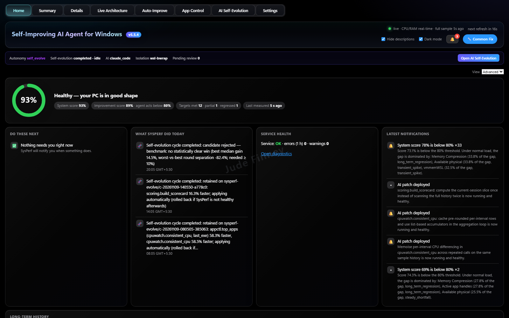
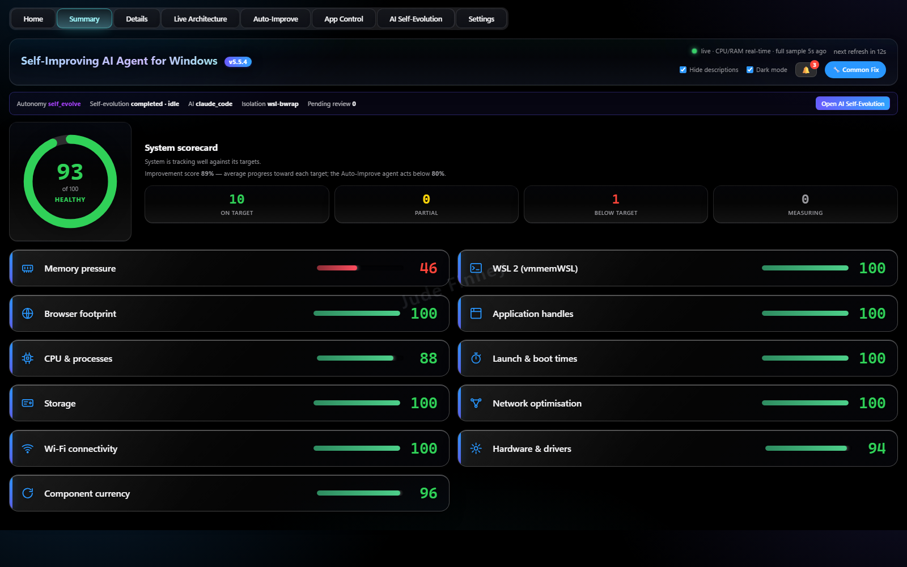
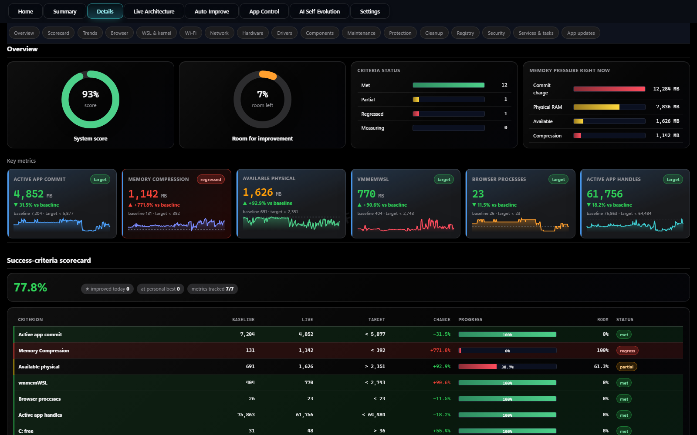

# SysPerf — System Performance Agent

**A self-improving performance dashboard for Windows 11.** SysPerf measures your PC, learns that machine's own
baseline, scores progress against targets derived from its actual capacity, and tells you exactly what to change.
With your consent it makes the safe changes itself, and every one can be undone.

Free from the [Microsoft Store](https://apps.microsoft.com/detail/9P558WJTTC0B) (Windows 11).

## Features

### Targets from your machine, not someone else's
- On first run SysPerf captures a baseline and derives targets from your actual RAM, disk size and measured process
  floor. A 64 GB workstation and an 8 GB laptop get different targets.
- One **system score** with a per-criterion breakdown: now, target, progress and status for every measurement.

### Finds out why your PC is slow

- **Memory:** commit charge, memory compression, available physical memory.
- **Processes and browsers:** background apps, browser-engine processes and browser memory.
- **Storage, network and power:** disk space, Wi-Fi congestion, battery wear, power plans.
- **Startup, hardware and drivers:** startup programs, old third-party drivers, platform and WSL settings.
- Prioritised **recommendations** (high / medium / low) explaining what to change and why.

### Safe, reversible fixes

- **Changes nothing without your permission.** Every fix is shown first, applied only with consent, and can be
  undone.
- **Autonomous improvement** with root-cause analysis: it re-measures after each change and keeps only what helps.
- **AI self-evolution:** proposed improvements to SysPerf itself are built and tested in a sandbox, with automatic
  rollback.

### Private and secure
- Runs locally on your PC. DNS-rebinding protection, a Content-Security-Policy, an encrypted API-key file and a
  hash-locked supply chain.
- [Privacy policy](packaging/msix/PRIVACY.md).

## Support
Report a problem or ask a question in [Issues](https://github.com/buildsbeyondai-code/WindowsAI/issues), or email
**buildsbeyondai@gmail.com**.

## Source code
The source code is private. For access, collaboration or questions, contact **buildsbeyondai@gmail.com**.

---
© 2026 Jude Finney. All rights reserved. SysPerf is a trademark of Jude Finney. Windows and Microsoft Store are
trademarks of the Microsoft group of companies.
