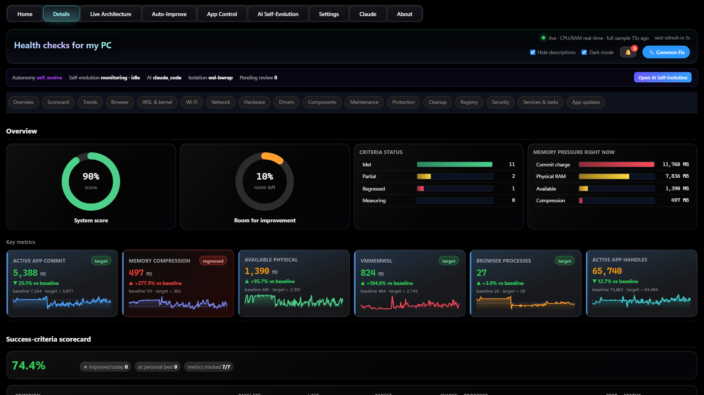
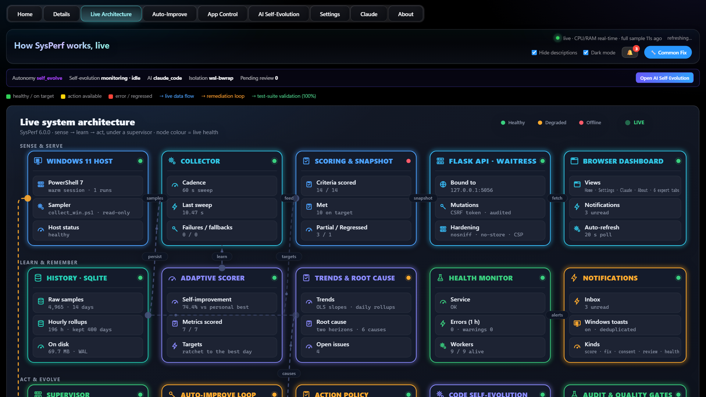
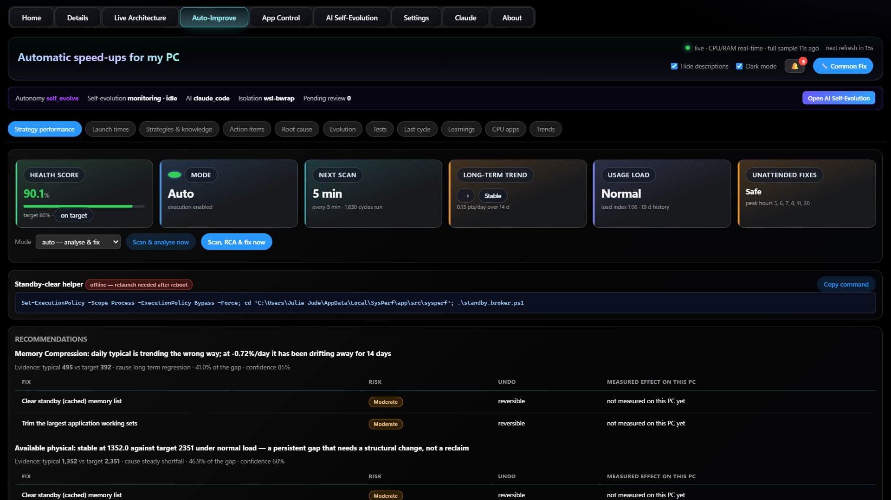
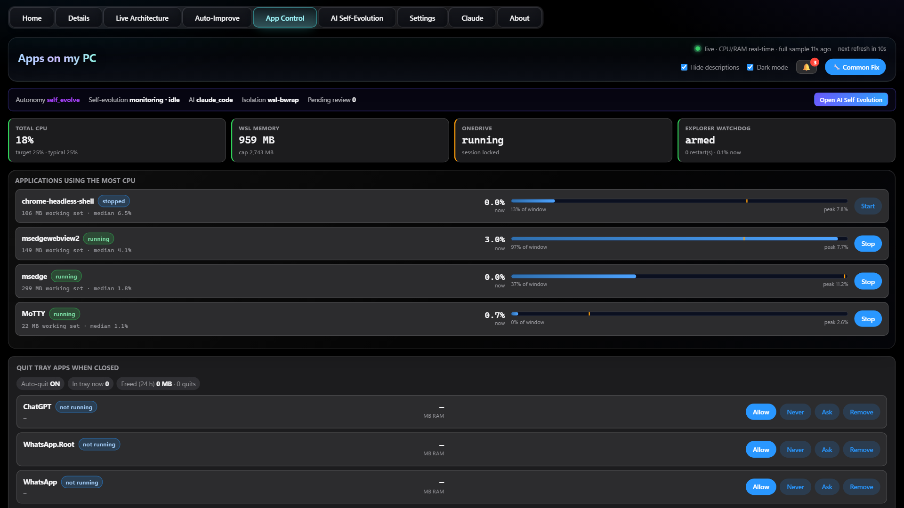
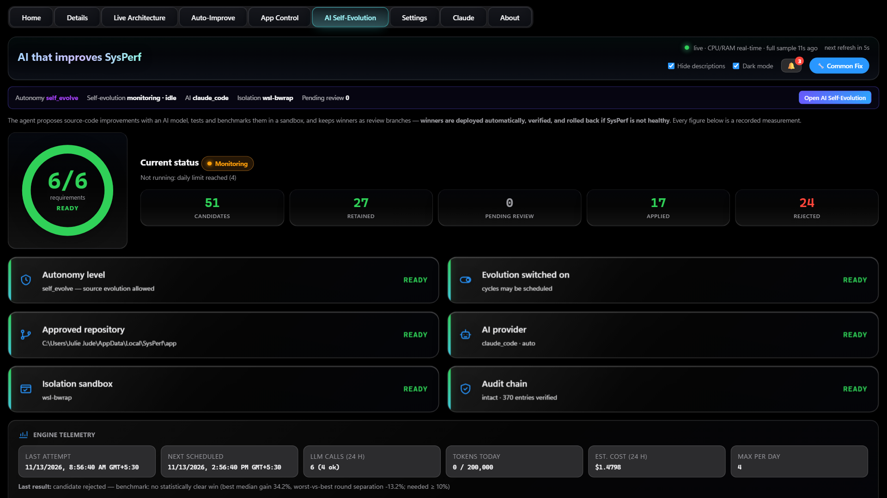
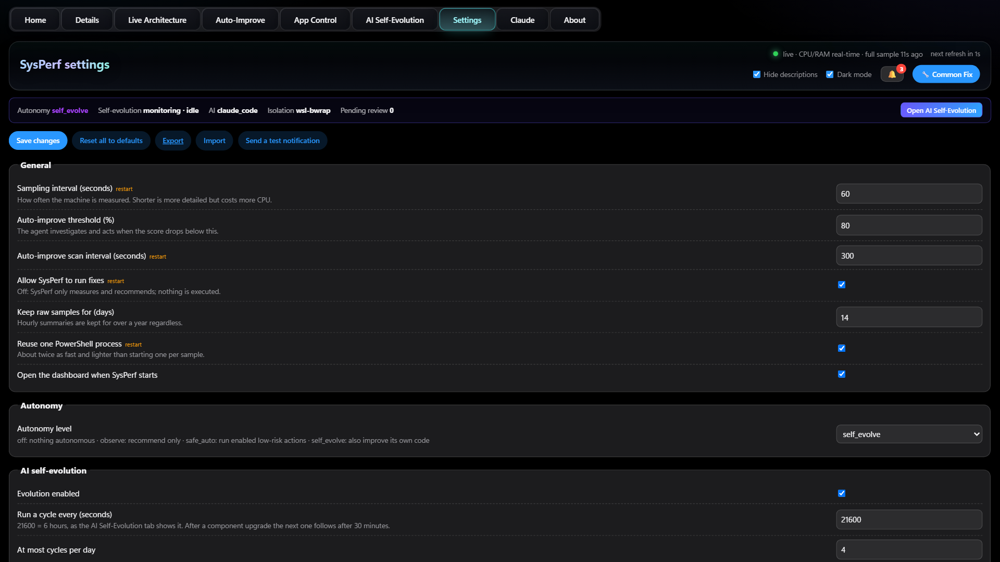
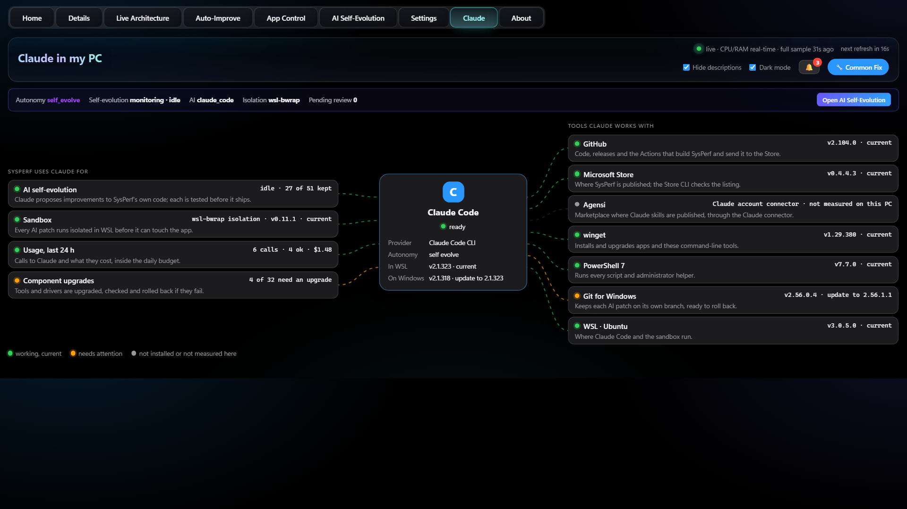
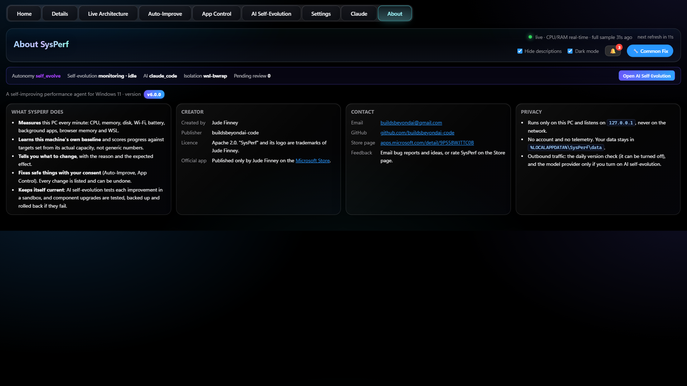

# Sysperf: Self-Improving Agentic AI for Windows Optimization

**A self-improving performance agent for Windows 11.** SysPerf measures your PC, learns that machine's own
baseline, scores progress against targets derived from its actual capacity, and tells you exactly what to change.
With your consent it makes the safe changes itself, and every one can be undone.

Free from the [Microsoft Store](https://apps.microsoft.com/detail/9P558WJTTC0B) (Windows 11). Current version: **6.0**.

**The dashboard has nine tabs:** [Home](#1-home) · [Details](#2-details) · [Live Architecture](#3-live-architecture) ·
[Auto-Improve](#4-auto-improve) · [App Control](#5-app-control) · [AI Self-Evolution](#6-ai-self-evolution) ·
[Settings](#7-settings) · [Claude](#8-claude) · [About](#9-about)

Then every section of the Details tab: [Details — all 17 sections](#details--all-17-sections)

Every tab shares the same header: a title naming what the tab is for, the version, a live indicator with the time of
the last full sample and the next refresh, a notifications bell, a **Common Fix** button, a dark-mode switch, and a
status strip showing the autonomy level, the self-evolution state, the AI provider, the sandbox and how many changes
are waiting for review.

## What's new in 6.0
- **Apps installed for all users update automatically.** Allow it once with one administrator prompt, and SysPerf
  updates them after each scan with no further prompt.
- **Components are always kept current:** Git for Windows, GitHub CLI, winget, PowerShell and the other tools, each
  upgrade tested first and rolled back if it fails. A release winget does not offer yet simply waits.
- **Stop a background service and it stays off,** also after a restart; Start brings it back.
- **A new Claude tab** shows the tools Claude Code works with, live.
- **Home now covers everything**, so the Summary tab is gone, and every tab is headed by its purpose.

---

## 1. Home

Your PC's health in plain words, on one screen.
- **System score ring:** one overall score (for example *90% — Healthy*) with a plain verdict.
- **Findings from Details:** apps needing an update, drivers and Windows parts behind the latest version, background
  services that can be closed when not in use, registry health, junk files to clear, and virus and firewall
  protection. A finding not measured yet says *first scan pending*.
- **Everything SysPerf tracks:** a 0–100 tile for each area in everyday words — **Memory (RAM), Linux apps memory,
  Web browser load, Apps' system load, Processor (CPU), Start-up speed, Disk space & health, Internet settings,
  Wi-Fi, Hardware & drivers, Software up to date** — plus **Crashes (30 days)**. Each tile opens the Details
  scorecard behind it.

## 2. Details

Everything SysPerf measures, in 17 sections (each shown [at the end](#details--all-17-sections)): **Overview, Scorecard,
Trends, Browser, WSL and kernel, Wi-Fi, Network, Hardware, Drivers, Components, Maintenance, Protection, Cleanup,
Registry, Security, Services and tasks, and App updates.**
- **Overview:** system score, room for improvement, criteria status and **memory pressure right now** (commit
  charge, physical RAM, available memory, compression).
- **Key metrics** cards with sparklines, each showing the live value, the change against *your* baseline and the
  target.
- **Success-criteria scorecard:** baseline, live value, target, change, progress and status for every criterion,
  with improvements today and personal bests.
- **Services:** stop a third-party service you are not using (it stays off, also after a restart) or start it
  again. Security software, drivers, WSL, Hyper-V and SysPerf itself are never offered.
- **App updates and Components:** updates for your apps, including those installed for all users, and the
  command-line tools SysPerf relies on, each kept current automatically.

## 3. Live Architecture

A live map of how SysPerf works, with each part coloured by its health right now (healthy, degraded or offline).
- **Sense and serve:** the Windows 11 host and sampler, the collector, scoring and snapshots, the local API (bound
  to 127.0.0.1 only, with CSRF protection and security headers) and the browser dashboard.
- **Learn and remember:** the history database and its rollups, the adaptive scorer, trends and root cause, the
  health monitor and notifications.
- **Act and evolve:** the supervisor that restarts SysPerf after a crash or hang, the auto-improve loop (scan → root
  cause → fix → verify → learn), the action policy, code self-evolution, and the audit and quality gates.
- Real numbers on every card, such as samples stored, the last sweep time, criteria met and workers alive.

## 4. Auto-Improve

Automatic speed-ups for your PC, each one measured before and after, with undo.
- **Status cards:** health score against its target, mode (*Auto* or recommend-only), next scan, long-term trend,
  current usage load, and whether unattended fixes are safe right now (it avoids your peak hours).
- **Scan & analyse now** or **Scan, RCA & fix now** buttons.
- **Recommendations** with the evidence behind each one, then each fix with its **risk, how to undo it and the
  effect measured on your PC**.

## 5. App Control

Take back memory and CPU from apps you aren't using.
- Live totals for **CPU, WSL memory, OneDrive and the Explorer watchdog** (which restarts Explorer if it hangs).
- **Applications using the most CPU**, each with its memory, typical CPU and peak, and a **Stop** button.
- **Quit tray apps when closed:** for each one, choose **Allow, Never, Ask or Remove**, and set how long it may sit
  in the tray before it's closed.

## 6. AI Self-Evolution

SysPerf improves its own code, safely. **Off by default** and uses your own AI provider.
- A **readiness check**: autonomy level, evolution switched on, approved repository, AI provider, isolation sandbox
  and an intact audit chain.
- Each proposed improvement is **built and tested in a sandbox and benchmarked**. Winners are deployed, verified on
  the running service and **rolled back automatically** if SysPerf isn't healthy afterwards.
- Tool upgrades (Git for Windows, GitHub CLI, winget, PowerShell, Claude Code) are tested the same way.

## 7. Settings

Everything is adjustable, with a short explanation beside each option, validated before anything is saved.
- **Autonomy:** *off*, *observe* (recommend only), *safe_auto* (run enabled low-risk actions) or *self_evolve*.
- **Goals, scan timing, privacy** and **AI self-evolution** limits.
- **Save, reset to defaults, export, import**, and **send a test notification**.

## 8. Claude

Claude in your PC: Claude Code at the centre, what SysPerf uses it for (such as self-evolution), and the tools it
works with — GitHub, the Microsoft Store, winget, PowerShell 7, Git for Windows and more — each with a status
measured live on this PC.

## 9. About

The version, what SysPerf does, privacy, the licence and how to get support (buildsbeyondai@gmail.com).

## Details — all 17 sections
The Details tab has a sub-tab for every area SysPerf measures. Each one is shown below in order.

### Overview

System score, room for improvement, criteria status and memory pressure right now, then key-metric cards with
sparklines comparing each live value with *your* baseline and target.

### Scorecard

Every success criterion in one table: baseline, live value, target, change, progress, room left and status (met,
regressed or still measuring), with the number improved today and at a personal best.

### Trends

History charts for memory pressure, WSL memory, app handles, kernel pools, browser processes, CPU, remote network
connections and start-up programs, with target lines and the rate of change.

### Browser

Browser-engine processes broken down: which apps host WebView2, which processes can safely be closed, and Edge's
make-up (extensions, tabs, utility and main processes) with the memory extensions use.

### WSL and kernel

The WSL 2 guest, Windows kernel memory pools against their baseline, free disk space against its target, and
background churn (svchost and search-indexer processes).

### Wi-Fi

Signal quality, receive and transmit link rates, live traffic, connection details (band, channel, security, radio)
and charts of Wi-Fi speed, link rate and signal over time.

### Network

TCP connection footprint, active adapters, band and channel overlap with nearby networks (and the clearest
channel), and an optimisation plan that says which fixes are for your PC and which for your router.

### Hardware

Device health from Device Manager, storage and battery status, input devices, and a watchlist for known glitches
that Windows still reports as OK.

### Drivers

Signed and unsigned driver counts, any driver faults, and stale drivers older than four years, with their dates.

### Components

Every component that affects performance (drivers, WSL, PowerShell, Edge, firmware, Windows, Python and SysPerf's
own toolchain) with the current and latest version, the expected performance gain and whether an upgrade is
recommended. Versions are checked live against each vendor's newest release.

### Maintenance

A scheduled maintenance scan that flags problems such as unexpected shutdowns, explains how to repair Windows
files, and offers safe one-click tips like clearing browser caches.

### Protection

Restore points (SysPerf makes one before registry fixes and updates, and weekly), when Windows servicing last ran,
and a system-file check summary with repair steps.

### Cleanup

Reclaimable space in your TEMP folder, crash dumps, browser caches and the Windows Update cache, with **Clear**
buttons where it's safe. Large files are only listed; SysPerf never deletes your files.

### Registry

A read-only check for start-up and uninstall entries that point to programs that no longer exist. SysPerf is not a
registry cleaner; Microsoft doesn't support them.

### Security

Antivirus real-time protection and definition age, firewall status for each network profile, and crashes (blue
screens and apps that crashed).

### Services and tasks

Third-party services that start automatically, with their state, and third-party scheduled tasks, with advice on
delaying rather than disabling them.

### App updates

Automatic app updates through winget after each scan, one at a time with a restore point first. Apps that need an
administrator are updated together after a single prompt.

---

## Private and secure
- Runs locally on your PC. The dashboard is reachable only from this computer (127.0.0.1), with DNS-rebinding
  protection, a Content-Security-Policy, an encrypted API-key file and a hash-locked supply chain.
- **Changes nothing without your permission.** Every fix is shown first, and each one can be undone.
- No account, no analytics, no advertising and no telemetry. [Privacy policy](packaging/msix/PRIVACY.md).

## Support
Report a problem or ask a question in [Issues](https://github.com/buildsbeyondai-code/WindowsAI/issues), or email
**buildsbeyondai@gmail.com**.

## Source code
The source code is private. For access, collaboration or questions, contact **buildsbeyondai@gmail.com**.

---
© 2026 Jude Finney. All rights reserved. SysPerf is a trademark of Jude Finney. Windows and Microsoft Store are
trademarks of the Microsoft group of companies.
