# SysPerf — System Performance Agent

**A self-improving performance dashboard for Windows 11.** SysPerf measures your PC, learns that machine's own
baseline, scores progress against targets derived from its actual capacity, and tells you exactly what to change.
With your consent it makes the safe changes itself, and every one can be undone.

Free from the [Microsoft Store](https://apps.microsoft.com/detail/9P558WJTTC0B) (Windows 11).

**The dashboard has eight tabs:** [Home](#1-home) · [Summary](#2-summary) · [Details](#3-details) ·
[Live Architecture](#4-live-architecture) · [Auto-Improve](#5-auto-improve) · [App Control](#6-app-control) ·
[AI Self-Evolution](#7-ai-self-evolution) · [Settings](#8-settings)

Then every section of the Details tab: [Details — all 17 sections](#details--all-17-sections)

Every tab shares the same header: the version, a live indicator with the time of the last full sample and the next
refresh, a notifications bell, a **Common Fix** button, a dark-mode switch, and a status strip showing the autonomy
level, the self-evolution state, the AI provider, the sandbox and how many changes are waiting for review.

---

## 1. Home
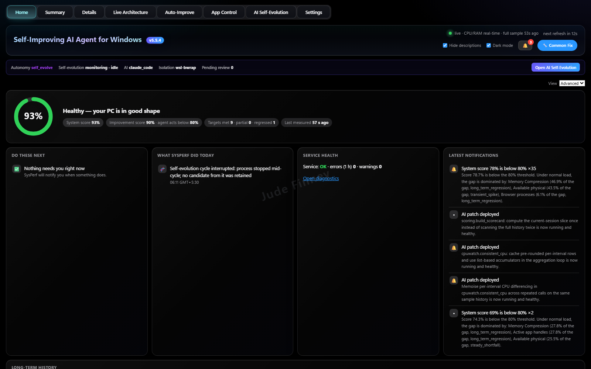

Your PC's health at a glance.
- **Health ring:** one overall score (for example *93% — Healthy*), with the system score, the improvement score,
  targets met, partial or regressed, and when the PC was last measured.
- **Do these next:** the few actions that matter right now, or *Nothing needs you right now*.
- **What SysPerf did today:** every fix, scan and self-evolution cycle it ran, with the time.
- **Service health:** whether SysPerf itself is running cleanly (errors and warnings in the last hour), with a link
  to diagnostics.
- **Latest notifications:** score drops with the cause behind them (for example *memory compression is 46.9% of the
  gap*), and AI patches that were deployed and are running healthily.
- **Long-term history** further down the page, plus a Beginner / Advanced view switch.

## 2. Summary
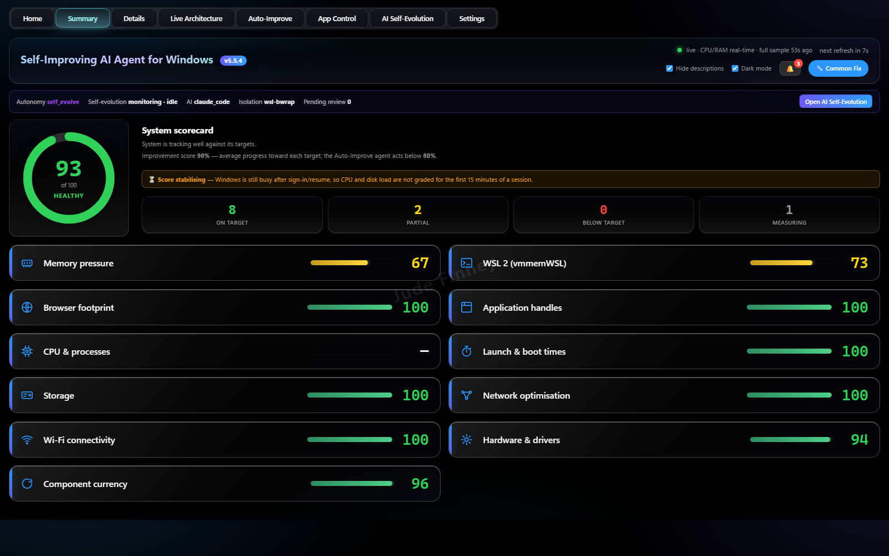

The system scorecard in one screen.
- A **score out of 100** with counts of criteria on target, partial, below target and still measuring.
- One bar and score for each area: **memory pressure, WSL 2, browser footprint, application handles, CPU and
  processes, launch and boot times, storage, network optimisation, Wi-Fi connectivity, hardware and drivers, and
  component currency** (how up to date your software is).
- A **score stabilising** notice right after sign-in or resume, so the first busy minutes of a session don't count
  against you.

## 3. Details
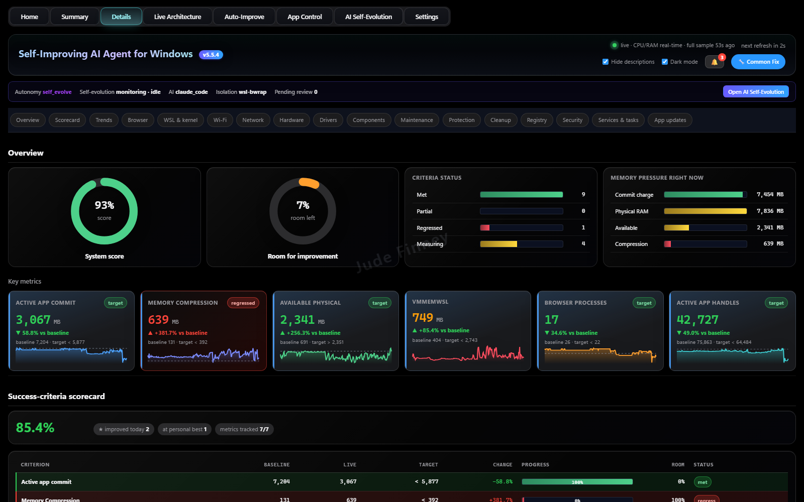

Everything SysPerf measures, in 17 sections (each shown [at the end](#details--all-17-sections)): **Overview, Scorecard, Trends, Browser, WSL and kernel, Wi-Fi,
Network, Hardware, Drivers, Components, Maintenance, Protection, Cleanup, Registry, Security, Services and tasks,
and App updates.**
- **Overview:** system score, room for improvement, criteria status and **memory pressure right now** (commit
  charge, physical RAM, available memory, compression).
- **Key metrics** cards with sparklines, each showing the live value, the change against *your* baseline and the
  target, for example active-app commit, memory compression, available physical memory, WSL memory, browser
  processes and app handles.
- **Success-criteria scorecard:** baseline, live value, target, change, progress and status for every criterion,
  with improvements today and personal bests.

## 4. Live Architecture
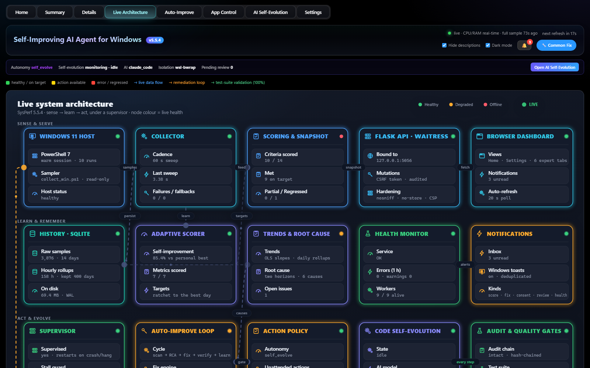

A live map of how SysPerf works, with each part coloured by its health right now (healthy, degraded or offline).
- **Sense and serve:** the Windows 11 host and sampler, the collector, scoring and snapshots, the local API (bound
  to 127.0.0.1 only, with CSRF protection and security headers) and the browser dashboard.
- **Learn and remember:** the history database and its rollups, the adaptive scorer, trends and root cause, the
  health monitor and notifications.
- **Act and evolve:** the supervisor that restarts SysPerf after a crash or hang, the auto-improve loop (scan → root
  cause → fix → verify → learn), the action policy, code self-evolution, and the audit and quality gates.
- Real numbers on every card, such as samples stored, the last sweep time, criteria met and workers alive.

## 5. Auto-Improve
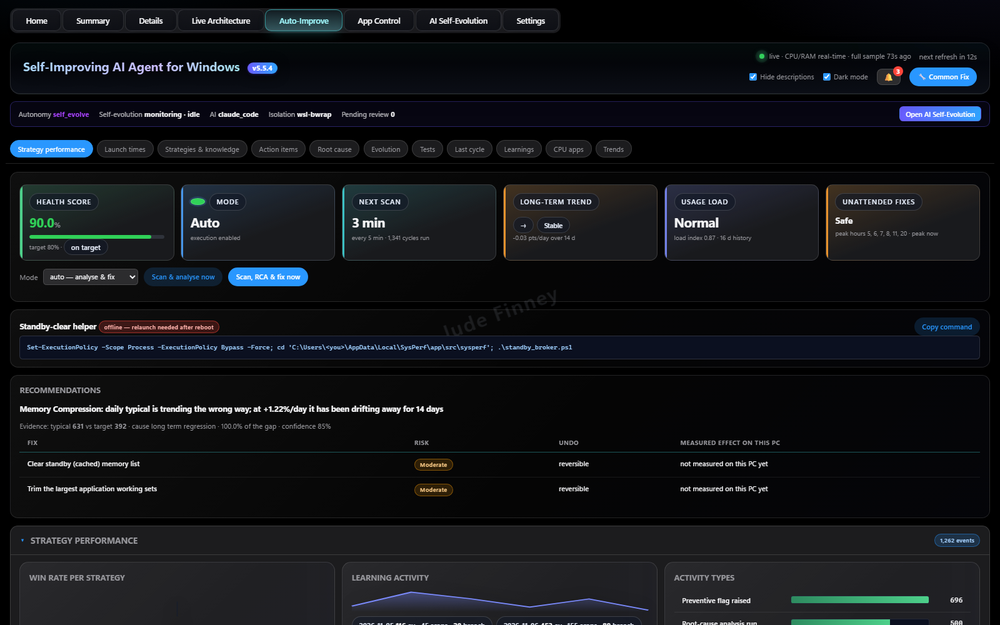

The agent that keeps your PC on target.
- **Status cards:** health score against its target, mode (*Auto* or recommend-only), next scan, long-term trend,
  current usage load, and whether unattended fixes are safe right now (it avoids your peak hours).
- **Scan & analyse now** or **Scan, RCA & fix now** buttons.
- **Recommendations** with the evidence behind each one, then each fix with its **risk, how to undo it and the
  effect measured on your PC**.
- Sections for strategy performance (win rate per strategy, learning activity), launch times, strategies and
  knowledge, action items, root cause, evolution, tests, the last cycle, learnings, CPU-heavy apps and trends.

## 6. App Control
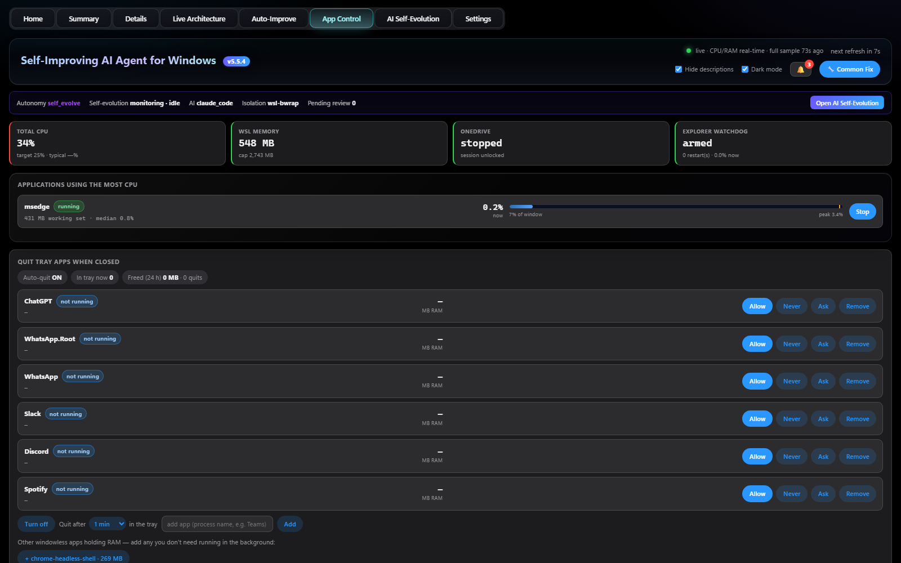

Take back memory and CPU from apps you aren't using.
- Live totals for **CPU, WSL memory, OneDrive and the Explorer watchdog** (which restarts Explorer if it hangs).
- **Applications using the most CPU**, each with its memory, typical CPU and peak, and a **Stop** button.
- **Quit tray apps when closed:** apps such as chat or music players that keep running in the tray after you close
  them. For each one, choose **Allow, Never, Ask or Remove**, and set how long it may sit in the tray before it's
  closed. It shows how much memory was freed in the last 24 hours, and suggests other background apps holding RAM.

## 7. AI Self-Evolution
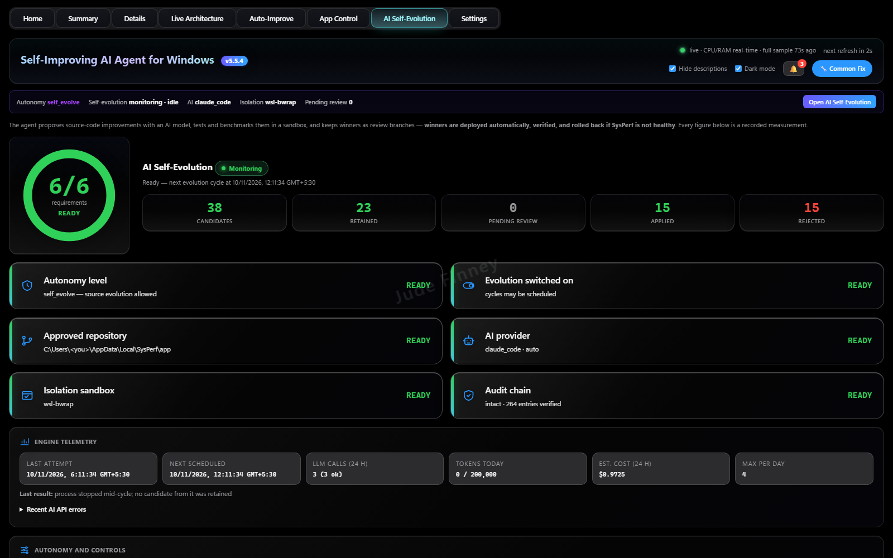

SysPerf improves its own code, safely. **Off by default** and uses your own AI provider key.
- A **readiness check** (for example *6/6 requirements ready*): autonomy level, evolution switched on, approved
  repository, AI provider, isolation sandbox and an intact audit chain.
- Counts of **candidates, retained, pending review, applied and rejected** changes.
- Each proposed improvement is **built and tested in a sandbox and benchmarked**. Winners are deployed, verified on
  the running service and **rolled back automatically** if SysPerf isn't healthy afterwards.
- **Engine telemetry:** last and next run, AI calls, tokens used today, estimated cost and the daily limit. Every
  figure is a recorded measurement.

## 8. Settings
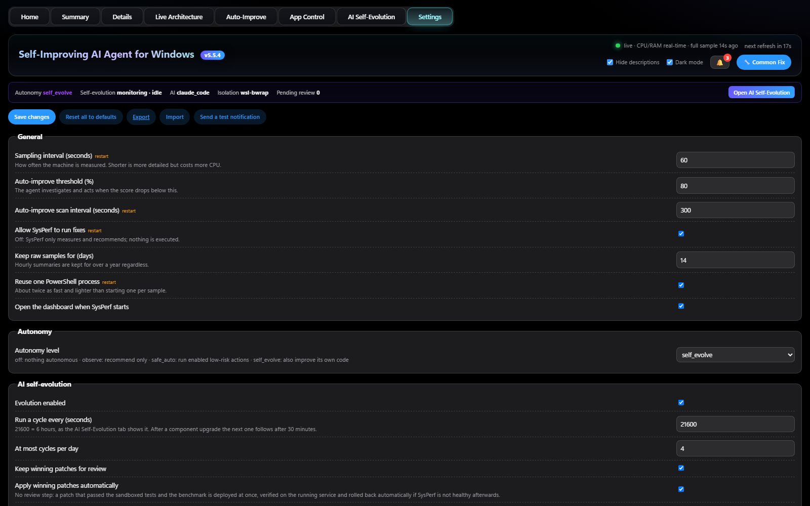

Everything is adjustable, with a short explanation beside each option.
- **General:** sampling interval, the score that triggers auto-improve, scan interval, whether SysPerf may run
  fixes at all, how long raw samples are kept, and whether the dashboard opens at start-up.
- **Autonomy:** *off*, *observe* (recommend only), *safe_auto* (run enabled low-risk actions) or *self_evolve*.
- **AI self-evolution:** on or off, how often and how many times a day it runs, and whether winning changes wait for
  your review or are applied automatically.
- **Save, reset to defaults, export, import**, and **send a test notification**.

## Details — all 17 sections
The Details tab has a sub-tab for every area SysPerf measures. Each one is shown below in order.

### Overview
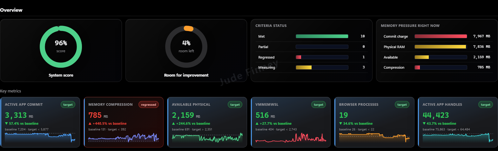

System score, room for improvement, criteria status and memory pressure right now, then key-metric cards with
sparklines comparing each live value with *your* baseline and target.

### Scorecard
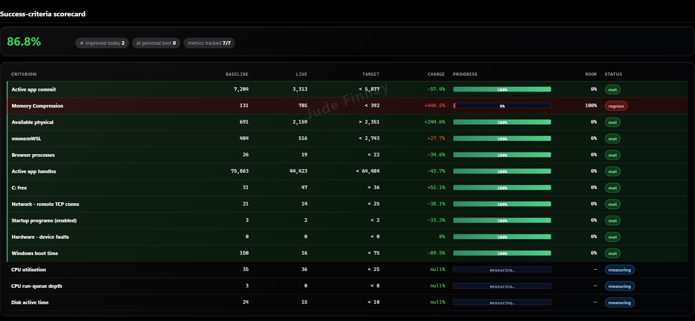

Every success criterion in one table: baseline, live value, target, change, progress, room left and status (met,
regressed or still measuring), with the number improved today and at a personal best.

### Trends
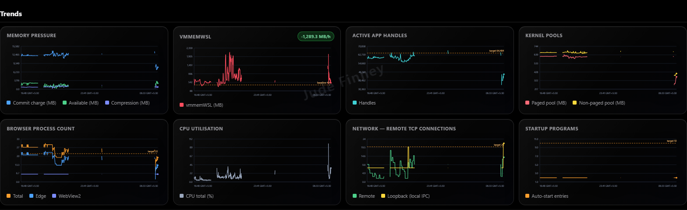

History charts for memory pressure, WSL memory, app handles, kernel pools, browser processes, CPU, remote network
connections and start-up programs, with target lines and the rate of change.

### Browser
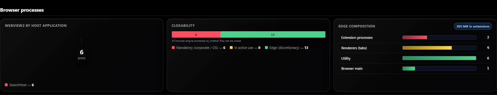

Browser-engine processes broken down: which apps host WebView2, which processes can safely be closed, and Edge's
make-up (extensions, tabs, utility and main processes) with the memory extensions use.

### WSL and kernel
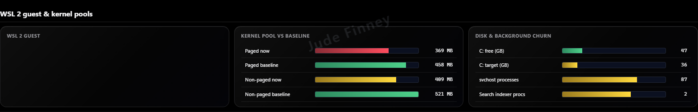

The WSL 2 guest, Windows kernel memory pools against their baseline, free disk space against its target, and
background churn (svchost and search-indexer processes).

### Wi-Fi
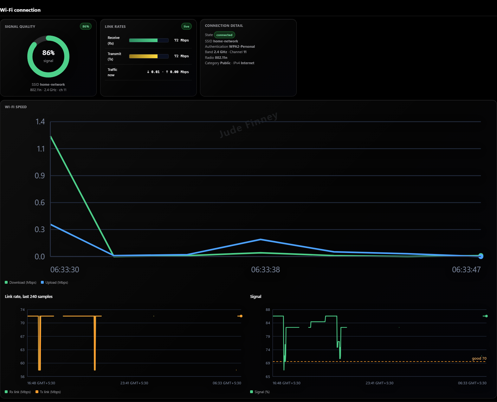

Signal quality, receive and transmit link rates, live traffic, connection details (band, channel, security, radio)
and charts of Wi-Fi speed, link rate and signal over time.

### Network
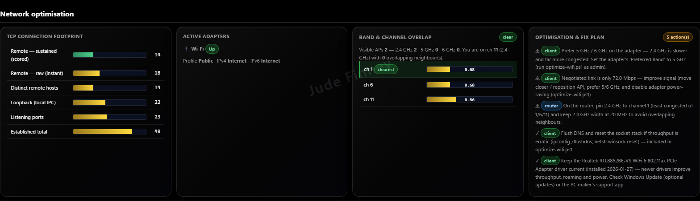

TCP connection footprint, active adapters, band and channel overlap with nearby networks (and the clearest
channel), and an optimisation plan that says which fixes are for your PC and which for your router.

### Hardware
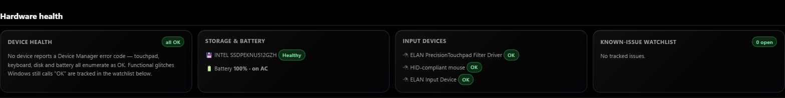

Device health from Device Manager, storage and battery status, input devices, and a watchlist for known glitches
that Windows still reports as OK.

### Drivers
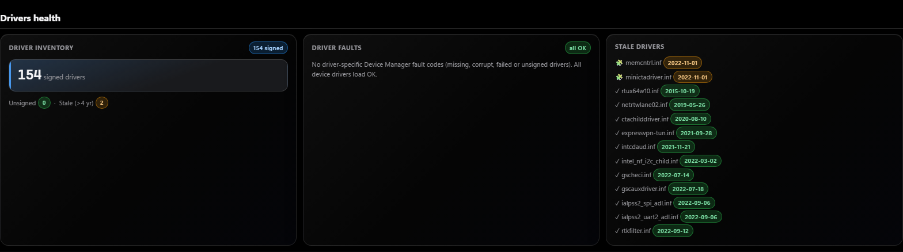

Signed and unsigned driver counts, any driver faults, and stale drivers older than four years, with their dates.

### Components
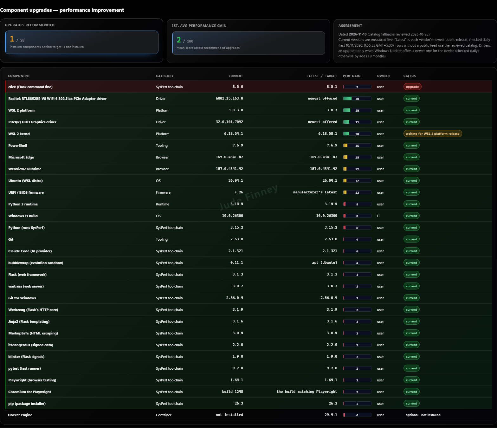

Every component that affects performance (drivers, WSL, PowerShell, Edge, firmware, Windows, Python and SysPerf's
own toolchain) with the current and latest version, the expected performance gain and whether an upgrade is
recommended. Versions are checked live against each vendor's newest release.

### Maintenance
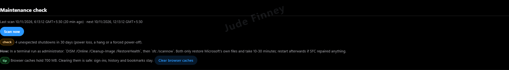

A scheduled maintenance scan that flags problems such as unexpected shutdowns, explains how to repair Windows
files, and offers safe one-click tips like clearing browser caches.

### Protection
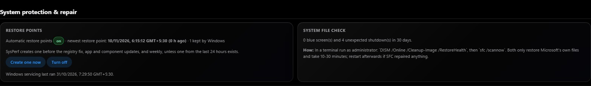

Restore points (SysPerf makes one before registry fixes and updates, and weekly), when Windows servicing last ran,
and a system-file check summary with repair steps.

### Cleanup
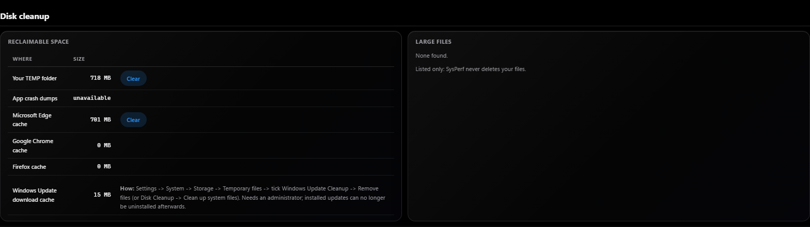

Reclaimable space in your TEMP folder, crash dumps, browser caches and the Windows Update cache, with **Clear**
buttons where it's safe. Large files are only listed; SysPerf never deletes your files.

### Registry
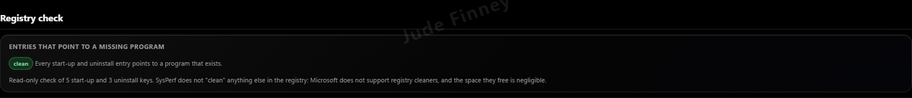

A read-only check for start-up and uninstall entries that point to programs that no longer exist. SysPerf is not a
registry cleaner; Microsoft doesn't support them.

### Security
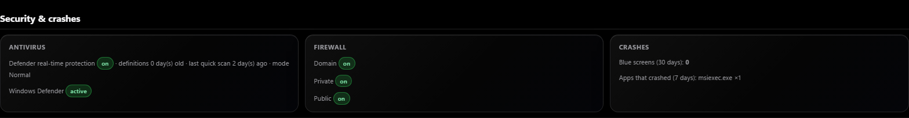

Antivirus real-time protection and definition age, firewall status for each network profile, and crashes (blue
screens and apps that crashed).

### Services and tasks
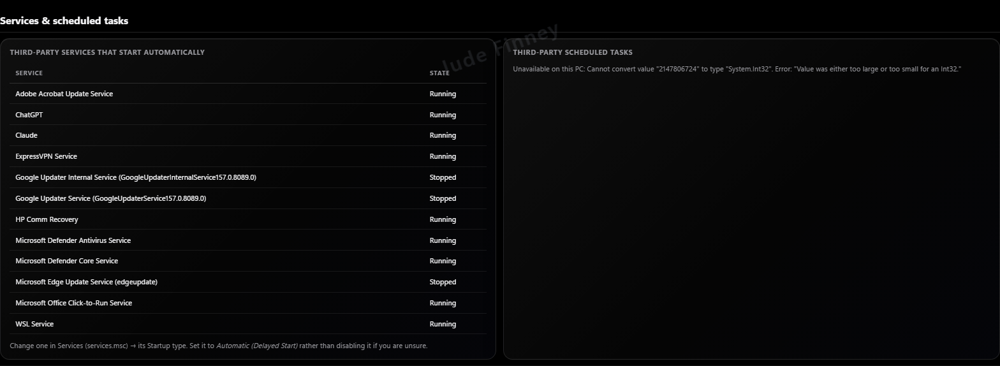

Third-party services that start automatically, with their state, and third-party scheduled tasks, with advice on
delaying rather than disabling them.

### App updates
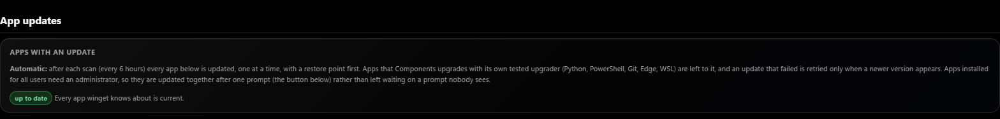

Automatic app updates through winget after each scan, one at a time with a restore point first. Apps that need an
administrator are updated together after a single prompt.

---

## Private and secure
- Runs locally on your PC. The dashboard is reachable only from this computer (127.0.0.1), with DNS-rebinding
  protection, a Content-Security-Policy, an encrypted API-key file and a hash-locked supply chain.
- **Changes nothing without your permission.** Every fix is shown first, and each one can be undone.
- No account, no analytics, no advertising and no telemetry. [Privacy policy](packaging/msix/PRIVACY.md).

## Support
Report a problem or ask a question in [Issues](https://github.com/buildsbeyondai-code/WindowsAI/issues), or email
**buildsbeyondai@gmail.com**.

## Source code
The source code is private. For access, collaboration or questions, contact **buildsbeyondai@gmail.com**.

---
© 2026 Jude Finney. All rights reserved. SysPerf is a trademark of Jude Finney. Windows and Microsoft Store are
trademarks of the Microsoft group of companies.
